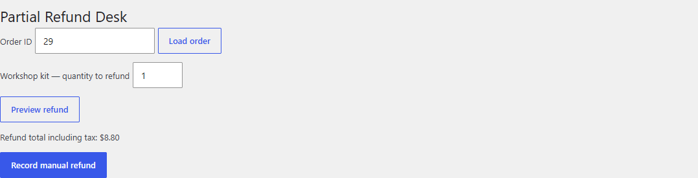

# Partial Refund Desk for WooCommerce

An original CodexaWP portfolio demo for reviewing and recording manual WooCommerce refunds. The preview calculates a line's remaining discounted amount and tax after previous refunds. The recorded operation uses the WooCommerce refund API on the test order.

## Try it

Open **WooCommerce → Partial Refund Desk** as a shop manager, load a test order by ID, enter a quantity, and preview the amount. Confirming records a manual refund. Create and use sample orders in a disposable store.

## Verification

Activate this plugin on a disposable WordPress site with WooCommerce active and `WP_ENVIRONMENT_TYPE` set to `local`. Set `CODEXAWP_TEST_WP_LOAD` to the absolute path to that site's `wp-load.php`, then run `php tests/check.php` from this repository.

The fixture covers a discounted taxable line, retrying the same confirmation, an excessive quantity and the remaining amount after an earlier refund.

## License

GPL-2.0-or-later. See [LICENSE](LICENSE).
